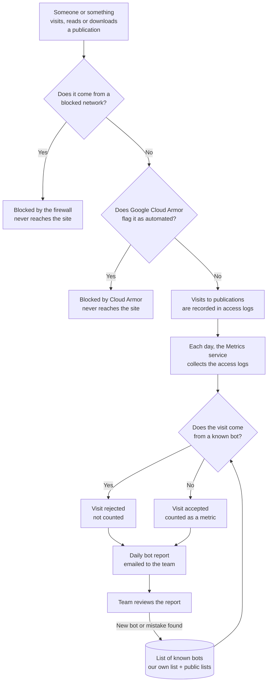

# Bot Detection & Reports

## Why we filter bots

Usage metrics should show how many **people** read or download a publication. A large share of web traffic comes from automated programs: search engine crawlers, AI agents, link checkers and scrapers. If we counted them, the numbers would be inflated and misleading.

The Metrics service checks every visit it collects from access logs and removes the visits that come from bots before any metric is counted.

## How it works

1. **Keeping a list of known bots.** We maintain a list of bot "signatures". It combines our own list with public, community-maintained lists, including the [COUNTER Robots list](https://github.com/atmire/COUNTER-Robots), [crawler-user-agents](https://github.com/monperrus/crawler-user-agents) and the [Matomo bot list](https://github.com/matomo-org/device-detector). The list is cleaned and merged so each bot is recognised once.
2. **Checking each visit.** Every visit to a website includes a short description of the program used to make it, called the *user agent* (for example, "Chrome on Windows" or "Googlebot"). Each day, when the access logs are collected, the user agent of every visit is compared with the bot list.
3. **Counting only people.** Visits that match a known bot are rejected and never become metrics. All other visits are counted as normal.
4. **Sending a daily report.** Once all access logs for a day have been processed, the system emails a summary to the metrics team. It lists the most common visitors that were rejected as bots and those that were accepted as people.
5. **Reviewing and improving.** The team reads the report to spot new bots that slipped through, or real visitors that were blocked by mistake, and updates the bot list.

### A firewall before everything else

There is an extra layer of protection that acts **before** all of the steps above. Our websites run on Google Cloud, and a firewall stops a large part of the unwanted traffic before it reaches the website.

- **It blocks whole networks, not individual visitors.** Every device on the internet has an address (an *IP address*). Addresses are grouped into networks, and each network belongs to one organisation, such as an internet provider, a university or a hosting company. Each network has its own number, called an *ASN*.
- **The blocked networks are data centres and cloud hosting companies.** These are the places where automated programs run in large numbers, and real readers rarely browse from them. The firewall keeps one rule per blocked network.
- **Blocked traffic is turned away entirely.** It never reaches the website and never appears in the access logs, so it can never be counted as a metric.
- **Trusted services are let through.** A few partner services that need to contact our websites are explicitly allowed, even when they come from a hosting network.
- **The rules are kept up to date.** When monitoring shows an unusual spike in traffic, the source is checked and, if it is automated, its network is added to the firewall.

### Google Cloud Armor

Traffic that gets past the firewall then goes through [Google Cloud Armor](https://cloud.google.com/security/products/armor), Google's security service that sits in front of our websites. It is a second layer of bot filtering, still applied **before** a visit reaches the website or the access logs. Cloud Armor looks at the behaviour of each request, not just where it comes from, and turns away traffic that looks automated, for example a visitor sending far more requests than a person could.

The layers work together. The firewall stops large volumes of traffic from networks known to host bots. Cloud Armor catches automated traffic coming from other networks. The bot list then catches the bots that get through, for example search engines and AI agents, which come from ordinary networks but identify themselves in their user agent.

## Flow chart

## Sample report

This is an extract of a real daily report. Each row is one type of visitor that was rejected as a bot:

- **Count**: how many visits it made that day.
- **User Agent**: how the visitor described itself.
- **Client Hints**: extra details about the visitor's browser and device.
- **Matching Regex**: the rule from the bot list that recognised it.

The report then lists the visitors that were **accepted** as people, so the team can check that no bot was missed.

  

    
From access_logs

    
Subject Bot detections on 2026-11-14

  

  

    <h3 class="bot-email__title">Bot &amp; User Agent Report</h3>
    <dl class="bot-email__meta">
      <dt>Provider</dt><dd>access_logs</dd>
      <dt>Search Date</dt><dd>2026-11-14</dd>
      <dt>Reporting Period</dt><dd>14 November 2026 (Full Day)</dd>
      <dt>Email Sent</dt><dd>2026-11-17 10:31:13 UTC</dd>
    </dl>
    <h4 class="bot-email__section">Rejected User Agents</h4>
    

      
<strong>49,499</strong>rejected log entries

      
<strong>823</strong>unique bot signatures

    

    
Showing top 100 of 823 unique rejected user-agent/regex pairs.

    

      <table class="bot-email__table">
        <thead>
          <tr><th>Count</th><th>User Agent</th><th>Client Hints</th><th>Matching Regex</th></tr>
        </thead>
        <tbody>
          <tr><td>14,305</td><td>Mozilla/5.0 AppleWebKit/537.36 (KHTML, like Gecko; compatible; Amzn-SearchBot/0.1) Chrome/119.0.6045.214 Safari/537.36</td><td>sec-ch-ua: "Amzn-SearchBot"; v="0", sec-ch-ua-mobile: ?1</td><td><code>Search+</code></td></tr>
          <tr><td>3,627</td><td>panscient.com</td><td>sec-ch-ua-mobile: ?0</td><td><code>panscient</code></td></tr>
          <tr><td>3,135</td><td>curl/8.5.0</td><td>sec-ch-ua: "curl"; v="8", sec-ch-ua-mobile: ?0</td><td><code>^.{1,10}$</code></td></tr>
          <tr><td>3,017</td><td>Mozilla/5.0 AppleWebKit/537.36 (KHTML, like Gecko; compatible; Claude-SearchBot/1.0; +searchbot@anthropic.com)</td><td>sec-ch-ua: "Claude-SearchBot"; v="1", sec-ch-ua-mobile: ?1</td><td><code>Search+</code></td></tr>
          <tr><td>2,918</td><td>Mozilla/5.0 Firefox/26.0</td><td>sec-ch-ua: "Firefox"; v="26", sec-ch-ua-mobile: ?0</td><td><code>^Mozilla/\d{1,2}(\.\d{1,4})? Firefox/\d{1,3}(\.\d{1,4})?$</code></td></tr>
          <tr><td>2,159</td><td>GoogleStackdriverMonitoring-UptimeChecks(https://cloud.google.com/monitoring)</td><td>sec-ch-ua-mobile: ?0</td><td><code>check</code></td></tr>
          <tr><td>1,466</td><td>Symfony HttpClient (Curl)</td><td>sec-ch-ua-mobile: ?0</td><td><code>curl</code></td></tr>
          <tr><td>1,442</td><td>Cloud-CDN-Google (GFE/2.0)</td><td>sec-ch-ua-mobile: ?0</td><td><code>-Google</code></td></tr>
          <tr><td>1,349</td><td>Mozilla/5.0 (Macintosh; Intel Mac OS X 10_14) AppleWebKit/605.1.15 (KHTML, like Gecko) Version/12.0 Safari/605.1.15 DeepDyve (www.deepdyve.com/DDBot)</td><td>sec-ch-ua: "DDBot", sec-ch-ua-mobile: ?1, sec-ch-ua-platform: "Mac OS X"</td><td><code>bot</code></td></tr>
        </tbody>
      </table>
    

    
… the email continues with the remaining rejected visitors and the <strong>Accepted User Agents</strong> section.

  

## Good to know

- **One report per day.** Each day's report is sent once. If delivery fails, it is not sent again automatically, so nobody receives duplicates.
- **Not 100% accurate.** New bots and AI agents appear all the time, and some disguise themselves as normal browsers. That is why the daily review matters: it keeps the bot list up to date.
